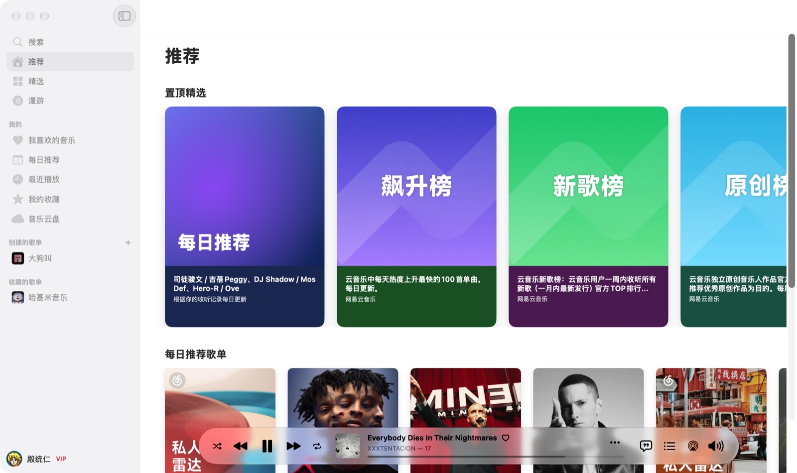
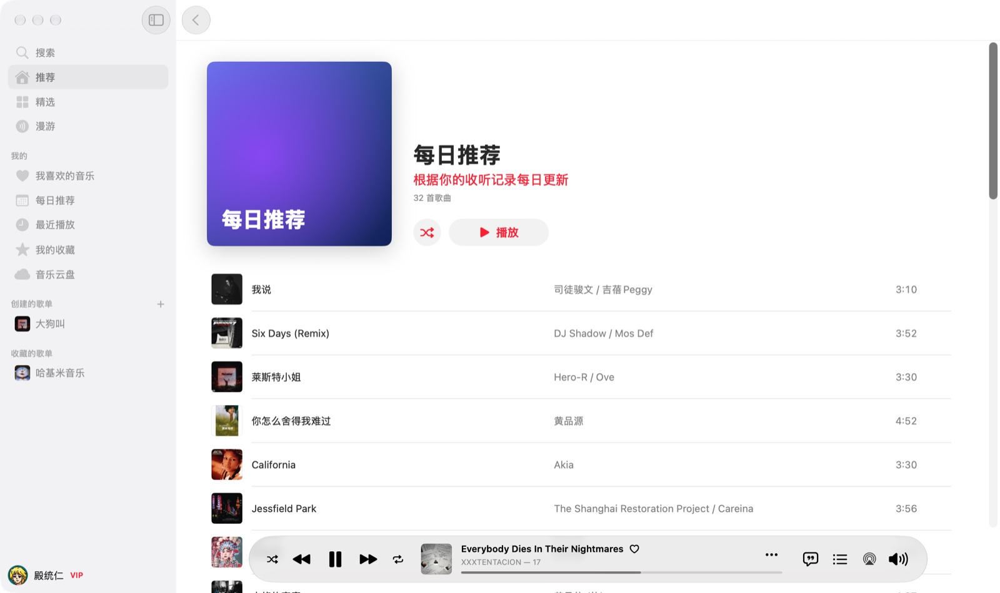
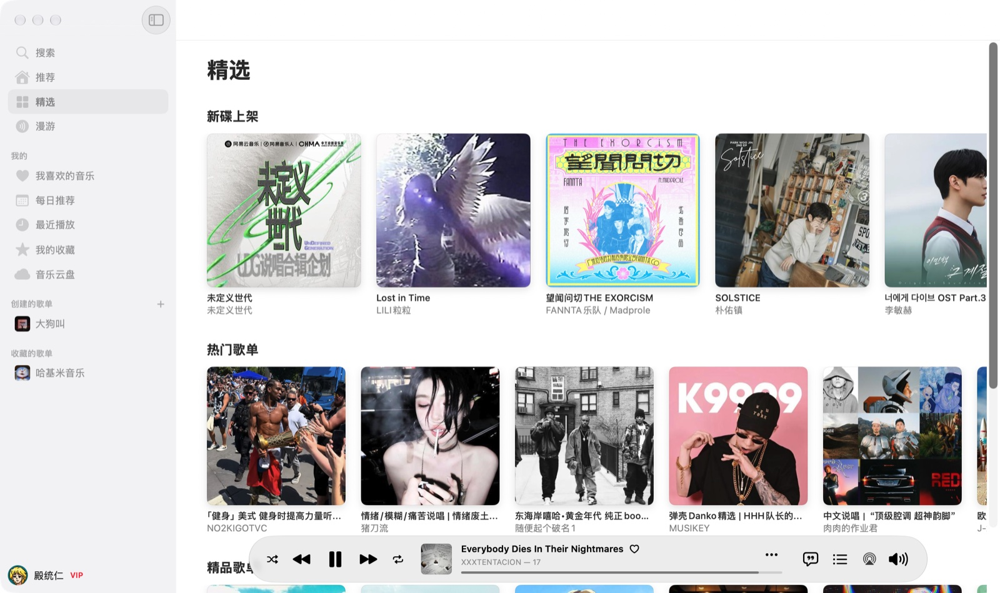

# Eseaten Music

[](https://github.com/diantongren/eseaten-music/actions/workflows/build.yml)

用 SwiftUI 写的原生 macOS 网易云音乐客户端，直接请求网易云官方接口，不依赖第三方代理服务器。



| 每日推荐 | 精选 |
|---|---|
|  |  |

## 功能

- 扫码登录，登录状态启动时自动续期
- 推荐：榜单、推荐歌单、新歌；精选：新碟、热门 / 精品歌单；漫游：私人漫游、排行榜
- 搜索歌曲、专辑、歌手、歌单
- 专辑 / 歌单 / 歌手详情页
- 我的：我喜欢的音乐、每日推荐、最近播放、收藏的专辑和歌手、音乐云盘
- 歌单管理：新建、删除、加歌，收藏 / 取消收藏
- 播放：播放条、待播清单、歌词、红心

## 下载

在 [Releases](https://github.com/diantongren/eseaten-music/releases/latest) 下载 `EseatenMusic.zip`，解压后把 `Eseaten Music.app` 拖进“应用程序”。需要 macOS 26，同时支持 Apple 芯片和 Intel。

App 只做了 ad-hoc 签名，没有经过 Apple 公证，首次打开前需要执行：

```bash
xattr -cr "/Applications/Eseaten Music.app"
```

## 构建

每次推送到 `main` 或提交 PR 时 GitHub Actions 会自动构建，产物在对应运行页面的 Artifacts 里。推送 `v*` tag（如 `v0.2.0`）会自动发布 Release，App 版本号取自 tag；带 `-` 的 tag（如 `v0.2.0-beta.1`）发成预发布版本。

本地构建需要 macOS 26 和 Xcode 26。工程文件由 [XcodeGen](https://github.com/yonaskolb/XcodeGen) 根据 `project.yml` 生成，不在仓库里：

```bash
brew install xcodegen
xcodegen generate
open EseatenMusic.xcodeproj
```

## 说明

- 本项目不是网易云音乐官方客户端，接口随时可能变动，仅供个人学习交流使用。
- VIP 和无版权的歌曲按网易云账号本身的权限播放，不做任何解锁。
- 登录 Cookie 只保存在本机 `~/Library/Application Support/com.eseaten.music/`。
- 接口和加密方式整理在 [docs/netease-api.md](docs/netease-api.md)。

## 致谢

感谢 [missuo/kumone](https://github.com/missuo/kumone)（LGPL-3.0）。本项目的网易云接口路径、weapi / eapi 加密方式和侧边栏结构都参考了它，代码用 Swift 6 独立重写。

## 许可证

[MIT](LICENSE)
